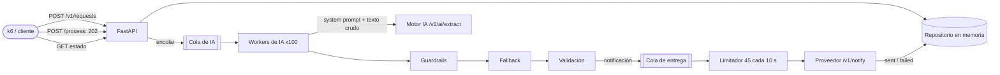

# Intelligent Notification Service

[English](README.md)

Servicio FastAPI que convierte una petición en lenguaje natural ("Manda un email a ana@test.com diciendo hola") en una
notificación: un motor de IA extrae `{to, message, type}`, unos guardrails limpian y validan su respuesta y el
proveedor de notificaciones la envía. Solución al reto descrito en [CHALLENGE.md](CHALLENGE.md).

**Prueba de carga oficial: 100 % de disponibilidad, 0,62 ms de latencia media en `/process` y ratio de llamadas a la IA
de 1,10** (los tres paneles del scorecard en verde); el 99 % de las peticiones terminó `sent`.

## Ejecutar

Requisitos: Docker. Desde la raíz del repositorio, exactamente como lo describe el reto:

```bash
docker-compose up -d provider influxdb grafana
docker-compose up -d --build app
docker-compose run --rm load-test
```

Scorecard: <http://localhost:3000/d/ia-performance-scorecard/>. Salud y backlogs: <http://localhost:5000/health>.

```bash
curl -X POST localhost:5000/v1/requests -H "Content-Type: application/json" \
     -d '{"user_input": "Manda un mail a feda@test.com diciendo hola"}'      # 201 {"id": "..."}
curl -X POST localhost:5000/v1/requests/<id>/process                       # 202 {"id": "...", "status": "queued"}
curl localhost:5000/v1/requests/<id>                                       # 200 {"id": "...", "status": "sent"}
```

Desarrollo local (Python 3.12):

```bash
uv venv --python 3.12 .venv
uv pip install --python .venv -r app/requirements-dev.txt
.venv/Scripts/python -m pytest        # Windows; .venv/bin/python en Linux/macOS
.venv/Scripts/ruff check . && .venv/Scripts/ruff format --check app evals
```

## Arquitectura



Una petición pasa por `queued → processing → sent | failed`. La capa HTTP solo encola. Los workers de IA extraen,
reparan y validan; los workers de entrega envían al ritmo del proveedor y fijan el estado final.

| Capa | Contenido |
|---|---|
| `api/` | Rutas y esquemas de petición/respuesta |
| `domain/` | `NotificationRequest`, `Status`, `Notification` (validada), patrones de contacto |
| `services/` | `pipeline` (cola y workers de IA), `processor` (una petición de principio a fin, política de reintentos de IA), `extractor` (cliente de IA), `guardrails`, `fallback_extractor`, `notifier` (limitador, reintentos, cola de entrega) |
| `infra/` | Repositorio en memoria, logs JSON |
| `prompts/` | El system prompt versionado |

## Comportamiento

| Situación | Resultado |
|---|---|
| Respuesta de IA limpia o ruidosa (bloques Markdown, claves renombradas o extra, comillas simples, claves sin comillas, cortada tras el último valor) | Reparada, sin nueva llamada a la IA, `sent` |
| Respuesta de IA sin `to` o sin `type` | Se recupera del texto de la petición, `sent` |
| Rechazo de la IA, respuesta ilegible, respuesta sin mensaje, timeout o 5xx de la IA | Un reintento, después `failed` (`ai_refused`, `ai_output_unreadable`, `missing_message`, `ai_unavailable`) |
| Petición sin destinatario ("manda un mensaje diciendo hola") | `failed`, `missing_information`, sin reintento |
| Destinatario que no cuadra con el canal (un email a un teléfono) | `failed`, `invalid_notification` |
| El proveedor responde 429, 5xx o no responde a tiempo | Hasta 3 intentos con backoff, después `failed` (`rate_limited`, `provider_error`) |
| Más peticiones de las que admite el proveedor | Esperan su turno y se entregan en orden (mientras tanto, `processing`) |
| Cola de IA llena | `/process` sigue respondiendo 202; la petición se queda `queued` con `reason: queue_full` |
| `/process` llamado dos veces | Idempotente: se encola una vez y devuelve el estado actual |
| Id desconocido | 404 |

La respuesta de estado añade un campo opcional `reason` cuando una petición falló o está esperando; `id` y `status`
del contrato no cambian.

## Decisiones de diseño

Resumen en [docs/DECISIONS.es.md](docs/DECISIONS.es.md); cada una tiene su ADR en [docs/adr](docs/adr). En resumen:

- **202 y workers en segundo plano**: `/process` nunca espera a la IA ni devuelve un error por saturación interna.
- **Prompting**: instrucciones solo en el system prompt
  ([app/prompts/extract_system.md](app/prompts/extract_system.md)), el mensaje user es la petición tal cual. El mock lee
  el último mensaje user con expresiones regulares, así que cualquier palabra nuestra ("email", una dirección de
  ejemplo) cambiaría su respuesta; con un modelo real, sacar las instrucciones del turno del usuario es la defensa
  básica frente a prompt injection.
- **Guardrails, fallback, validación**: las 16 formas de respuesta del mock se aprovechan sin otra llamada; el
  destinatario y el canal se pueden recuperar de la petición, el mensaje nunca.
- **Como mucho un reintento de IA**, solo cuando otra llamada puede ayudar.
- **Pipeline en dos etapas**: las notificaciones esperan en su propia cola, tras un limitador que replica la regla del
  proveedor (como mucho 45 llamadas en cualquier ventana de 10 s, frente a las 50 del proveedor): una ráfaga sale de
  golpe mientras la ventana tiene hueco, y los workers de IA nunca esperan detrás del límite.
- **Caché de extracciones desactivada por defecto**: con cuatro frases repetidas ocultaría el coste real.

## Cómo se ha probado

**122 tests automáticos** (`pytest`), más `ruff`, en CI en cada push:

| Área | Tests | Qué cubren |
|---|---|---|
| Guardrails | `test_guardrails.py` (40) | El propio generador del proveedor forzado por cada una de sus ramas (16 formas de respuesta × email y SMS), tipos de rechazo, llaves y comillas dentro de los valores, nulls, teléfonos numéricos, sinónimos del tipo, salida irreparable |
| Política de reintentos | `test_processor.py` (16) | Un reintento solo por rechazos, respuestas cortadas, falta de mensaje y timeouts; sin reintento por JSON sucio, falta de información, clave mala o destinatario inválido; conteo de intentos; caché activada/desactivada |
| Notificador | `test_notifier.py` (18) | Ventana deslizante (una ráfaga de 45 sin esperar, la siguiente cuando sale la más antigua de la ventana, nunca más de 45 en 10 s, sin espera tras un periodo inactivo), reintentos ante 429/5xx/timeouts, motivos al rendirse, sin reintento ante 422, backoff exponencial con jitter, `Retry-After`, estados de entrega, backlog acotado |
| Fallback y validación | `test_fallback_extractor.py`, `test_notification.py` (14) | Los cuatro prompts de k6, nunca inventar el mensaje, números internacionales, coherencia destinatario/canal |
| Cliente de IA | `test_extractor.py` (8) | System prompt + mensaje user crudo, API key, clasificación de errores, contenido nulo |
| Evaluación del prompt | `test_prompt_eval.py` (4) | Respuestas grabadas de un modelo real a 20 casos, juzgadas con las mismas reglas del servicio; el juez detecta respuestas equivocadas e inventadas |
| API, pipeline, operación | `test_api.py`, `test_pipeline.py`, `test_end_to_end.py`, `test_observability.py`, `test_config.py` (22) | Códigos del contrato, endpoints ejecutados en el event loop, `/process` idempotente, cola llena, workers concurrentes, el worker sobrevive a un fallo, de la ingesta a `sent` a través de la app real con el proveedor simulado, health, logs JSON |

Los tests se comprobaron contra fallos introducidos a propósito (un reintento de más, reintentar la falta de
información, no reintentar respuestas cortadas, quitar la reparación de truncados o `ast.literal_eval`): cada fallo
hizo fallar al menos un test. Una comprobación que ningún test detectaba resultó ser código muerto y se eliminó.

### Evaluación del system prompt

El mock ignora el system prompt, así que la prueba de carga no puede decir si funciona.
[docs/prompt-eval.es.md](docs/prompt-eval.es.md) lo evalúa con un modelo real en 20 casos (las frases de k6 más prompt
injection, canales contradictorios, varios destinatarios, datos que faltan, y códigos, fechas e importes que deben
llegar intactos), juzgados con los mismos guardrails, fallback y validación del servicio:

| Respuestas de | Correctas |
|---|---|
| Claude Opus 5.5, subagente con contexto limpio, con el system prompt | **20 / 20** |
| El mock del reto | 5 / 20 |

En este ejercicio no hay API key, así que las respuestas del modelo las generó una vez un subagente que solo vio el
system prompt y las peticiones, y la CI las reproduce. **En un proyecto real esta comprobación se haría contra la API
del modelo** en cada cambio del prompt o del modelo, con varias ejecuciones por caso; `evals/record_answers.py` y
`evals/report.py` hacen justo eso en cuanto `PROVIDER_BASE_URL` apunta a la pasarela real.

**Comprobaciones manuales** contra el proveedor real: los cuatro prompts de k6 terminan `sent`; "manda un mensaje
diciendo hola" termina `failed` con `missing_information`.

### Prueba de carga oficial (k6, portátil, Docker Desktop en Windows)


| Panel | Resultado | Verde si |
|---|---|---|
| Disponibilidad | **100 %** (8.247 peticiones, 0 fallidas, 19.243 checks correctos) | ≥ 99 % |
| Latencia media de `/process` | **0,62 ms** (p95 de todas las peticiones 1,3 ms) | < 400 ms |
| Llamadas a la IA por `/process` | **1,10** (3.021 / 2.749) | < 1,5 |

El panel de "concurrencia máxima" (199 usuarios virtuales) es informativo; su color rojo es el del panel por defecto,
no un umbral.

Qué pasó con las 2.749 peticiones, según los logs JSON una vez vacío el backlog de entrega:

| Resultado | Peticiones | Detalle |
|---|---|---|
| `sent` | **2.725 (99,1 %)** | 2.477 con una llamada a la IA, 248 tras un reintento |
| `failed: ai_refused` | 24 (0,9 %) | Rechazadas dos veces; el mock rechaza el 10 % de las veces, así que ~1 % de las peticiones recibe dos rechazos |
| Reintentos de IA | 296 | Todos por rechazos; no se reintentó ninguna respuesta sucia |
| 429 del proveedor | **0** de 2.725 llamadas de notificación | Todas las notificaciones salieron al primer intento |

El backlog de entrega (unas 2.300 notificaciones cuando la extracción se puso al día, un minuto después de acabar k6)
tardó unos 9 minutos en vaciarse, a 4,5 por segundo de media (45 cada 10 s).

**Probándolo a mano**, 30 peticiones enviadas a la vez desde el navegador llegan a `sent` con una mediana de 2,8 s, que
es la latencia de la propia IA; las que necesitaron un reintento de IA tardan unos 5 s. Una primera versión del
limitador espaciaba cada llamada 0,22 s y daba una mediana de 5,3 s en la misma prueba; por eso se sustituyó (ADR 5).

## Limitaciones conocidas

- El estado y las colas viven en memoria, en un proceso: un reinicio pierde las peticiones encoladas y no entregadas
  (ADR 7).
- El límite de ritmo es por instancia; con varias instancias haría falta un limitador compartido, porque la cuota del
  proveedor es global (ADR 5).
- Tras una ráfaga larga, la entrega se vacía a 4,5/s de media: unos 9 minutos para el backlog que deja la prueba de
  carga. No hay edad máxima por notificación.
- El limitador cuenta las llamadas cuando salen, no cuando llegan al proveedor; el margen de 5 (45 frente a 50) cubre
  esa diferencia, y los reintentos absorben un 429 si llegara a producirse. Un `NOTIFY_WINDOW_MAX_CALLS` menor da más
  margen.
- Los guardrails comprueban la estructura, no la veracidad: el servicio confía en que el modelo no invente el
  mensaje. El prompt lo prohíbe y la evaluación lo comprueba (sin contenido no hay notificación), pero solo una
  evaluación con el modelo real puede hacerlo.
- El mock ignora el system prompt y extrae mal el mensaje (los primeros 50 caracteres, o el texto tras el último ":",
  así que "cita a las 10:00" se queda en "00"). El servicio envía lo que extrajo la IA; nunca reescribe el mensaje.
- Los tipos de rechazo se distinguen por su texto (ADR 4).
- La caché de extracciones, si se activa, no tiene límite de tamaño ni TTL (ADR 6).

## Configuración

Variables de entorno (ver [.env.example](.env.example) y `app/config.py`):

| Variable | Valor por defecto | Significado |
|---|---|---|
| `PROVIDER_BASE_URL` | `http://localhost:3001` | Motor de IA y proveedor de notificaciones |
| `PROVIDER_API_KEY` | `test-dev-2026` | La clave pública de test del reto; el docker-compose dado no pasa variables de entorno |
| `WORKERS` | `100` | Extracciones de IA concurrentes |
| `QUEUE_MAX_SIZE` | `10000` | Límite de cada cola |
| `AI_TIMEOUT_S` | `10` | Timeout por llamada a la IA |
| `AI_MAX_RETRIES` | `1` | Reintentos de IA por petición |
| `EXTRACTION_CACHE_ENABLED` | `false` | Reutilizar extracciones de peticiones idénticas |
| `NOTIFY_WINDOW_MAX_CALLS` | `45` | Llamadas de notificación permitidas en cualquier ventana deslizante (el proveedor admite 50) |
| `NOTIFY_WINDOW_S` | `10` | Duración de esa ventana, en segundos |
| `NOTIFY_MAX_ATTEMPTS` | `3` | Intentos por notificación |
| `NOTIFY_BACKOFF_S` | `0.5` | Primer backoff, que se dobla, con jitter |
| `NOTIFY_MAX_RETRY_AFTER_S` | `30` | Tope para el `Retry-After` del proveedor |
| `NOTIFY_CONCURRENCY` | `10` | Notificaciones en vuelo |
| `NOTIFY_TIMEOUT_S` | `5` | Timeout por llamada de notificación |
| `LOG_LEVEL` | `INFO` | Logs JSON con `request_id`, `reason` y número de intentos |

## Estructura del repositorio

Los ficheros del reto se mantienen tal cual (`provider/`, `platform/`, `docker-compose.yaml`, `CHALLENGE.md`; solo se
renombró el `readme.md` original, para que no choque con este README en sistemas de ficheros que no distinguen
mayúsculas): el revisor lanza la prueba de carga oficial sin cambios. La solución está en `app/`; la evaluación del system prompt, en
`evals/`.

## Desarrollo asistido por IA

Hecho con Claude Code (Anthropic) como pair programmer.

- **Qué hizo la IA**: leyó el código del proveedor y las consultas del scorecard para ver qué miden de verdad las
  pruebas, escribió el código y los tests primero el test (cada test se vio fallar antes de la implementación), lanzó
  la prueba de carga oficial y capturó el scorecard, y redactó esta documentación. Un subagente aparte, con contexto
  limpio, respondió como el modelo a los casos de la evaluación del prompt, viendo solo el system prompt y las
  peticiones.
- **Qué se validó a mano**: las decisiones de diseño y sus compromisos (entrega en dos etapas, como mucho un
  reintento, nunca inventar el mensaje, la caché desactivada), el system prompt, los resultados del scorecard y cada
  línea de este README y de los ADRs.
- **Guardarraíles**: la batería de tests automáticos (dirigida por el propio generador de respuestas del proveedor),
  las comprobaciones con fallos introducidos a propósito, `ruff`, CI en cada push y la prueba k6 oficial.
