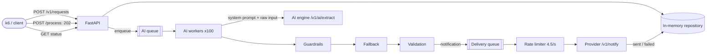
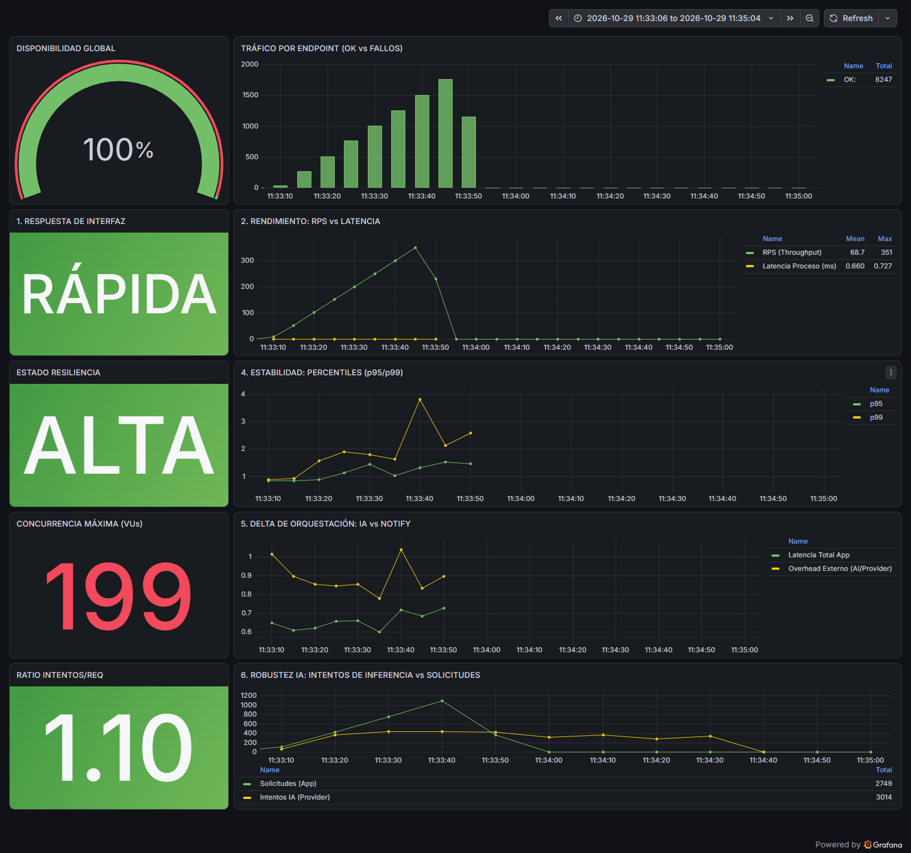

# Intelligent Notification Service

[Español](README.es.md)

FastAPI service that turns a natural-language request ("Send an email to ana@test.com saying hello") into a
notification: an AI engine extracts `{to, message, type}`, guardrails clean and validate its answer, and the
notification provider sends it. Solution to the challenge described in [CHALLENGE.md](CHALLENGE.md).

**Official load test: 100 % availability, 0.66 ms mean `/process` latency, AI call ratio 1.10** (all three scorecard
panels green); 99 % of the requests ended `sent`.

## Run

Requirements: Docker. From the repository root, exactly as the challenge describes:

```bash
docker-compose up -d provider influxdb grafana
docker-compose up -d --build app
docker-compose run --rm load-test
```

Scorecard: <http://localhost:3000/d/ia-performance-scorecard/>. Health and backlogs: <http://localhost:5000/health>.

```bash
curl -X POST localhost:5000/v1/requests -H "Content-Type: application/json" \
     -d '{"user_input": "Manda un mail a feda@test.com diciendo hola"}'      # 201 {"id": "..."}
curl -X POST localhost:5000/v1/requests/<id>/process                       # 202 {"id": "...", "status": "queued"}
curl localhost:5000/v1/requests/<id>                                       # 200 {"id": "...", "status": "sent"}
```

Local development (Python 3.12):

```bash
uv venv --python 3.12 .venv
uv pip install --python .venv -r app/requirements-dev.txt
.venv/Scripts/python -m pytest        # Windows; .venv/bin/python on Linux/macOS
.venv/Scripts/ruff check . && .venv/Scripts/ruff format --check app
```

## Architecture



A request moves `queued → processing → sent | failed`. The HTTP layer only enqueues. AI workers extract, repair and
validate; delivery workers send at the provider's pace and set the final status.

| Layer | Content |
|---|---|
| `api/` | Routes and request/response schemas |
| `domain/` | `NotificationRequest`, `Status`, `Notification` (validated), contact patterns |
| `services/` | `pipeline` (AI queue and workers), `processor` (one request end to end, AI retry policy), `extractor` (AI client), `guardrails`, `fallback_extractor`, `notifier` (rate limiter, retries, delivery queue) |
| `infra/` | In-memory repository, JSON logging |
| `prompts/` | The versioned system prompt |

## Behaviour

| Situation | Outcome |
|---|---|
| Clean or noisy AI answer (fences, renamed or extra keys, single quotes, unquoted keys, cut after the last value) | Repaired, no new AI call, `sent` |
| AI answer without `to` or `type` | Recovered from the request text, `sent` |
| AI refusal, unreadable answer, answer without a message, AI timeout or 5xx | One retry, then `failed` (`ai_refused`, `ai_output_unreadable`, `missing_message`, `ai_unavailable`) |
| Request without a recipient ("manda un mensaje diciendo hola") | `failed`, `missing_information`, no retry |
| Recipient that does not match the channel (an email to a phone number) | `failed`, `invalid_notification` |
| Provider answers 429, 5xx or times out | Up to 3 attempts with backoff, then `failed` (`rate_limited`, `provider_error`) |
| More requests than the provider can take | They wait their turn and are delivered in order (`processing` meanwhile) |
| Full AI queue | `/process` still answers 202; the request stays `queued` with `reason: queue_full` |
| `/process` called twice | Idempotent: enqueued once, returns the current status |
| Unknown id | 404 |

The status response adds an optional `reason` field when a request failed or is waiting; the contract's `id` and
`status` are unchanged.

## Design decisions

Summary in [docs/DECISIONS.md](docs/DECISIONS.md); each one has an ADR in [docs/adr](docs/adr). In short:

- **202 and background workers**: `/process` never waits for the AI and never returns an error for internal
  saturation.
- **Prompting**: instructions only in the system prompt ([app/prompts/extract_system.md](app/prompts/extract_system.md)),
  the user message is the request as typed. The mock reads the last user message with regular expressions, so any
  word of ours ("email", an example address) would change its answer; with a real model, keeping instructions out of
  the user turn is the basic defence against prompt injection.
- **Guardrails, fallback, validation**: every one of the mock's 16 answer shapes becomes usable without a new call;
  the recipient and channel can be recovered from the request, the message never is.
- **At most one AI retry**, only when another call can help.
- **Two-stage pipeline**: notifications wait in their own queue, paced at 4.5/s evenly spaced (the provider allows 50
  per sliding 10 s), so the AI workers never wait behind the rate limit.
- **Extraction cache off by default**: with four repeated sentences it would hide the real cost.

## How it was tested

**113 automated tests** (`pytest`), plus `ruff`, run in CI on every push:

| Area | Tests | What they cover |
|---|---|---|
| Guardrails | `test_guardrails.py` (39) | The provider's own generator forced through each of its branches (16 answer shapes × email and SMS), refusal kinds, braces and quotes inside values, nulls, numeric phones, type synonyms, unrepairable output |
| Retry policy | `test_processor.py` (16) | One retry only for refusals, cut answers, missing messages and timeouts; no retry for dirty JSON, missing information, bad keys or invalid recipients; attempt counts; cache on/off |
| Notifier | `test_notifier.py` (15) | Even spacing (46 calls in 10 s at 4.5/s), retries on 429/5xx/timeouts, give-up reasons, no retry on 422, exponential backoff with jitter, `Retry-After`, delivery statuses, bounded backlog |
| Fallback and validation | `test_fallback_extractor.py`, `test_notification.py` (14) | The four k6 prompts, never inventing the message, international numbers, recipient/channel consistency |
| AI client | `test_extractor.py` (7) | System prompt + raw user message, API key, error classification |
| API, pipeline, operations | `test_api.py`, `test_pipeline.py`, `test_end_to_end.py`, `test_observability.py`, `test_config.py` (22) | Contract status codes, endpoints running on the event loop, idempotent `/process`, full queue, concurrent workers, worker survives a bug, intake to `sent` through the real app with a mocked provider, health, JSON logs |

The tests were checked against deliberate bugs (an extra retry, retrying missing information, not retrying cut
answers, removing the truncation repair or `ast.literal_eval`): each bug made at least one test fail. One check that
no test could catch turned out to be dead code and was removed.

**Manual checks** against the real provider: the four k6 prompts end `sent`; "manda un mensaje diciendo hola" ends
`failed` with `missing_information`.

### Official load test (k6, laptop, Docker Desktop on Windows)



| Panel | Result | Green when |
|---|---|---|
| Availability | **100 %** (8,247 requests, 0 failed, 19,243 checks passed) | ≥ 99 % |
| Mean `/process` latency | **0.66 ms** (p95 of all requests 1.4 ms) | < 400 ms |
| AI calls per `/process` | **1.10** (3,014 / 2,749) | < 1.5 |

The "max concurrency" panel (199 virtual users) is informational; its red colour is the panel's default, not a
threshold.

What happened to the 2,749 requests, from the JSON logs once the delivery backlog was empty:

| Outcome | Requests | Detail |
|---|---|---|
| `sent` | **2,721 (99.0 %)** | 2,484 with one AI call, 237 after one retry |
| `failed: ai_refused` | 28 (1.0 %) | Refused twice; the mock refuses 10 % of the time, so about 1 % of requests get two refusals |
| AI retries | 293 | All of them for refusals; no dirty answer was retried |
| Provider 429s | 5 of 2,726 notify calls | Right after the test, while the AI workers were clearing their backlog: under that event-loop load the gap between a rate-limiter slot and the call reaching the provider varies, and a few windows went over 50. All 5 were delivered on the next attempt |

The delivery backlog (about 2,200 notifications once extraction had caught up, a minute after k6 finished) took
about 8 minutes to drain, at the configured 4.5/s.

## Known limitations

- State and queues live in memory, in one process: a restart loses queued and undelivered requests (ADR 7).
- The rate limit is per instance; several instances would need a shared limiter, since the provider's quota is
  global (ADR 5).
- After a burst, delivery drains at 4.5/s: about 8 minutes for the backlog the load test leaves. There is no
  maximum age per notification.
- The rate limiter spaces calls when they leave, not when they arrive: under heavy event-loop load a few calls can
  still get a 429 (5 in the load test), which the retries absorb. A lower `NOTIFY_RATE_PER_S` gives more margin.
- The mock ignores the system prompt and extracts the message poorly (the first 50 characters, or the text after the
  last ":", so "cita a las 10:00" becomes "00"). The service forwards what the AI extracted; it never rewrites the
  message.
- Refusal kinds are told apart by their wording (ADR 4).
- The extraction cache, when enabled, has no size bound or TTL (ADR 6).

## Configuration

Environment variables (see [.env.example](.env.example) and `app/config.py`):

| Variable | Default | Meaning |
|---|---|---|
| `PROVIDER_BASE_URL` | `http://localhost:3001` | AI engine and notification provider |
| `PROVIDER_API_KEY` | `test-dev-2026` | The challenge's public test key; the given docker-compose passes no environment |
| `WORKERS` | `100` | Concurrent AI extractions |
| `QUEUE_MAX_SIZE` | `10000` | Bound of each queue |
| `AI_TIMEOUT_S` | `10` | Timeout per AI call |
| `AI_MAX_RETRIES` | `1` | AI retries per request |
| `EXTRACTION_CACHE_ENABLED` | `false` | Reuse extractions of identical requests |
| `NOTIFY_RATE_PER_S` | `4.5` | Notify calls per second, evenly spaced |
| `NOTIFY_MAX_ATTEMPTS` | `3` | Attempts per notification |
| `NOTIFY_BACKOFF_S` | `0.5` | First backoff, doubling, with jitter |
| `NOTIFY_CONCURRENCY` | `10` | Notifications in flight |
| `NOTIFY_TIMEOUT_S` | `5` | Timeout per notify call |
| `LOG_LEVEL` | `INFO` | JSON logs with `request_id`, `reason` and attempt counts |

## Repository layout

The challenge files are kept as provided (`provider/`, `platform/`, `docker-compose.yaml`, `CHALLENGE.md`; only the
original `readme.md` was renamed, so it does not clash with this README on case-insensitive file systems): the
reviewer runs the official load test unchanged. The solution lives in `app/`.

## AI-assisted development

Built with Claude Code (Anthropic) as a pair programmer.

- **What the AI did**: read the provider's code and the scorecard queries to find what the tests really measure,
  wrote the code and tests test-first (each test was seen failing before the implementation), ran the official load
  test and captured the scorecard, and drafted this documentation.
- **What was validated by hand**: the design decisions and their trade-offs (two-stage delivery, one retry at most,
  never inventing the message, the cache off), the system prompt, the scorecard results and every line of this README
  and the ADRs.
- **Guardrails**: the automated test suite (driven by the provider's own response generator), deliberate-bug checks,
  `ruff`, CI on every push, and the official k6 test.
